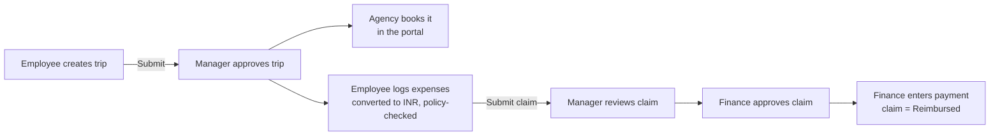
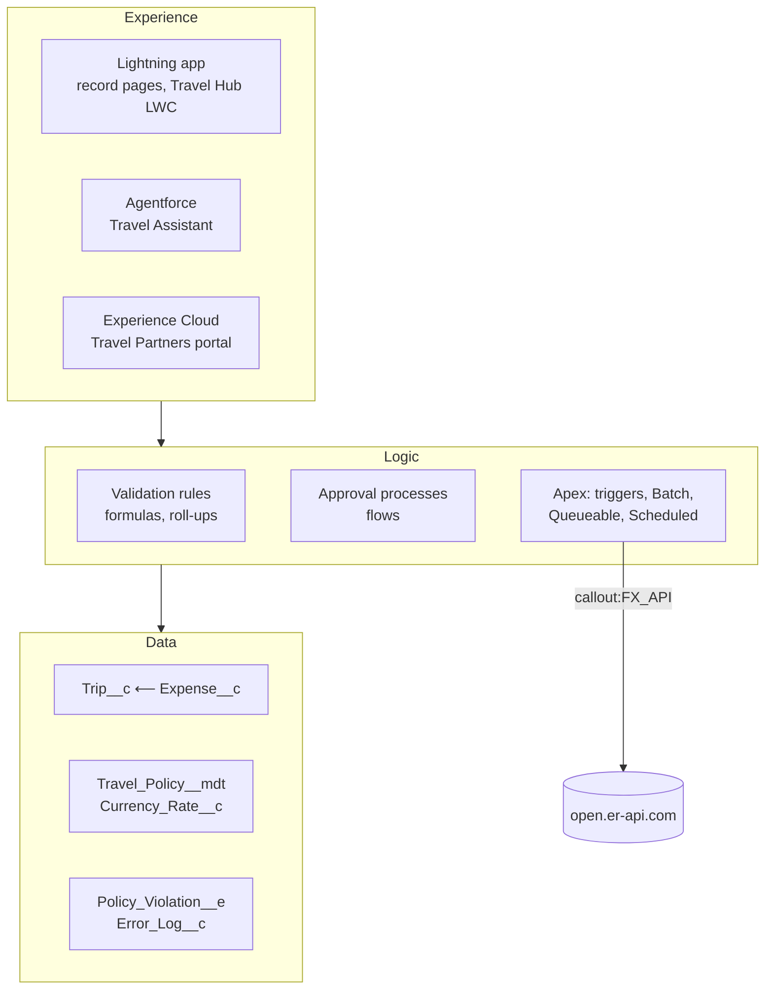

# WanderRoster

**Travel and expense management on Salesforce** for the fictional company *upquotient.com*, built for the Cognizant 2027 NPN Salesforce Hackathon (Challenge 3).

upquotient.com tracked business travel in spreadsheets: employees did not know their spending limits, approvals happened over email, foreign receipts were converted by hand, and Finance found duplicates and overspending only after paying. WanderRoster replaces that with one tracked journey, **from trip request to reimbursement**, where the company travel policy is checked automatically at every step.

---

## Contents

- [Who uses it](#who-uses-it)
- [How a trip works](#how-a-trip-works)
- [Features](#features)
- [Architecture](#architecture)
- [Data model](#data-model)
- [Security](#security)
- [Repository structure](#repository-structure)
- [Deploy to your own org](#deploy-to-your-own-org)
- [Testing](#testing)
- [Design decisions](#design-decisions)

---

## Who uses it

| Persona | Role (grade) | What they do in WanderRoster | Where |
|---|---|---|---|
| Employee | Sales Associate (G1) | Requests trips, logs expenses, submits one claim per trip, cancels trips | Lightning app |
| Manager | Sales Manager (G3) | Approves trips and the first level of claims | Lightning app |
| Finance | Finance Executive (G2) | Approves claims (second level), records payment, sees over-policy expenses live | Lightning app |
| CFO | CFO (G4) | Watches spend, exceptions and the claim pipeline on a dashboard | Lightning app |
| Travel agency | External partner | Books approved trips and enters the booking reference | Experience Cloud portal |

The employee's **grade** decides their spending limit for each expense category.

## How a trip works



- **Trip status:** Draft → Submitted → Approved / Rejected → Completed, or **Cancelled** (with a reason, before any money is spent).
- **Claim status:** Not Submitted → Submitted → Manager Approved → Finance Approved → Reimbursed, or Rejected.

## Features

| Area | What it does | Built with |
|---|---|---|
| Policy engine | Every expense is converted to INR and checked against the limit for the employee's grade and category (hotel limit × nights) the moment it is saved. Over-policy expenses need a justification. | Apex trigger + handler, Custom Metadata |
| Approvals | Trip → Manager. Claim → Manager → Finance queue. Payment reference marks the claim Reimbursed. | Approval processes, record-triggered flow |
| Data quality | 11 validation rules: valid dates, expenses only on approved trips and within trip dates, claim locked after submission, approved and cancelled trips locked, agency may edit only the booking reference. | Validation rules, Apex delete guard |
| Duplicate detection | Flags an expense with the same employee, date, category, amount and currency (any trip, and inside one bulk save). | Apex |
| Receipts | Attaching a file to an expense ticks *Has Receipt*. | Apex trigger on ContentDocumentLink |
| Cancel Trip | One button: asks for a reason, withdraws a pending approval, notifies the manager, and the cancellation is final. | Screen flow + invocable Apex |
| Notifications | Bell alerts on trip decisions, claim status changes, cancellations; reminder 2 days before travel; reminder tasks for unclaimed trips. | Flows, Apex, scheduled Batch |
| Live currency rates | Daily refresh of USD, EUR, GBP, AED, SGD → INR from a REST API. | Scheduled → Queueable callout, Named Credential |
| My Travel Hub | Employee home page: open trips, claims in approval, spend this year, budget bar, recent trips. | Lightning Web Component |
| Live Finance alerts | An over-policy expense appears on Finance's screen instantly. | Platform Event + LWC (empApi) |
| AI Travel Assistant | Answers "Can I claim a 6,000 rupee hotel?" and "Where is my claim?" using the employee's own grade and trips. | Agentforce agent + Apex actions |
| Partner portal | The travel agency sees only approved trips and can change only the booking reference. | Experience Cloud, sharing rule |
| Error logging | Failures in background jobs, notifications and flows are recorded for the admin instead of being lost. | Error_Log__c, ErrorLogger, flow fault paths |
| Analytics | 7 reports and a CFO dashboard (spend by category, monthly trend, budget vs actual, claim pipeline, over-policy and duplicates). | Reports, dashboard, custom report types |

## Architecture



Internal users work in the Lightning app; the external agency uses a separate Experience Cloud site on the same data with much narrower access.

## Data model

| Component | Type | Purpose |
|---|---|---|
| `Trip__c` | Custom object (Private) | One business trip **and its claim**: `Status__c` (trip approval) and `Claim_Status__c` (reimbursement), roll-ups of total spend and over-policy count, cancellation reason and date |
| `Expense__c` | Custom object, **Master-Detail** to Trip | One cost line: amount, currency, INR amount, policy limit, over-policy and duplicate flags, receipt flag |
| `Travel_Policy__mdt` | Custom Metadata (20 records) | Limit per Grade × Category, and the amount above which a receipt is required |
| `Currency_Rate__c` | Custom object (Public Read Only) | Cached rate to INR per currency, upserted daily on an external ID |
| `Policy_Violation__e` | Platform Event | Real-time over-policy message, published only after the save commits |
| `Error_Log__c` | Custom object (Private) | Errors and warnings caught by Apex and flow fault paths |
| `User.Grade__c` | Custom field | The employee's grade (G1–G4), which selects their limits |

Standard objects used: User (manager for approvals), Task (reminders), Files (receipts), Account/Contact (the partner agency), Group (Finance queue, agency group).

## Security

- **Org-wide defaults:** Trip Private, Expense controlled by parent, Currency Rate public read only, Error Log Private.
- **Role hierarchy:** CEO → CFO → Finance Executive; CEO → Sales Manager → Sales Associate. Managers see their team's trips.
- **Profiles:** a minimal *WanderRoster Base User* profile with no custom object access; a custom partner profile for the agency.
- **Permission sets:** `WR_Employee`, `WR_Finance`, `WR_Travel_Agency`, `WR_Support` (admin access to error logs). All app access is granted here.
- **Sharing rules:** submitted claims → Finance (CFO role and below); approved trips → travel agencies.
- **Apex:** every class is `with sharing`; user-facing queries use `WITH USER_MODE`; writes that must bypass field security (logging, cancellation) say so explicitly with `AccessLevel.SYSTEM_MODE`.

## Repository structure

```
WanderRoster/
├── force-app/main/default/         Salesforce metadata (deployed with the CLI)
│   ├── objects/                    Trip__c, Expense__c, Currency_Rate__c, Error_Log__c,
│   │                               Travel_Policy__mdt, Policy_Violation__e, User (Grade__c)
│   ├── customMetadata/             20 travel policy limits
│   ├── classes/                    Apex: handlers, async jobs, agent actions, services, tests
│   ├── triggers/                   One trigger per object (Expense, Trip, ContentDocumentLink)
│   ├── flows/                      4 record-triggered flows + Cancel Trip screen flow
│   ├── approvalProcesses/          Trip Approval, Claim Approval
│   ├── lwc/myTravelHub/            My Travel Hub component
│   ├── aiAuthoringBundles/         Agentforce agent definition (Agent Script)
│   ├── permissionsets/, profiles/, sharingRules/, groups/   Security
│   ├── networks/, navigationMenus/ Experience Cloud partner site
│   ├── reports/, reportTypes/, dashboards/                   Analytics
│   └── layouts/, flexipages/, tabs/, applications/, quickActions/   UI
├── scripts/
│   ├── setup/                      One-time org setup, run in number order
│   ├── ops/                        Pause / resume the daily jobs around deployments
│   └── generators/                 make_reports.py: generates the report metadata
├── specs/                          Agentforce agent specification
├── config/                         Scratch org definition
└── sfdx-project.json               Salesforce DX project file
```

## Deploy to your own org

**Prerequisites:** [Salesforce CLI](https://developer.salesforce.com/tools/salesforcecli) and a Developer Edition org with Digital Experiences and Agentforce enabled.

```bash
# 1. Connect your org
sf org login web --alias wr-dev --set-default

# 2. Deploy all metadata
sf project deploy start --source-dir force-app

# 3. Assign access (for your own user)
sf org assign permset --name WR_Employee --name WR_Finance --name WR_Support

# 4. Schedule the daily jobs (FX refresh 01:00, claim reminders 07:00)
sf apex run --file scripts/ops/resumeSchedules.apex

# 5. Optional: partner agency and demo data (edit user names inside the scripts first)
sf apex run --file scripts/setup/1-partnerSetup.apex
sf apex run --file scripts/setup/2-partnerPermset.apex
sf apex run --file scripts/setup/3-travelAgencyGroup.apex
sf apex run --file scripts/setup/4-demoData.apex

# 6. Publish and activate the AI agent
sf agent publish authoring-bundle --api-name WanderRoster_Travel_Assistant
sf agent activate --api-name WanderRoster_Travel_Assistant
```

Manual steps in Setup: create the demo users and roles, set each user's **Grade** and **Manager**, and publish the Experience Cloud site.

**Redeploying Apex later:** Salesforce blocks deploying classes used by scheduled jobs. Run `scripts/ops/pauseSchedules.apex`, deploy, then `scripts/ops/resumeSchedules.apex`.

## Testing

```bash
sf apex run test --test-level RunLocalTests --code-coverage --wait 20
```

**57 Apex tests, all passing, 88% org-wide coverage** (every WanderRoster class between 79% and 100%). Tests run as a real non-admin employee (`TestUserFactory`), mock the REST callout (success, HTTP error, timeout, invalid JSON), cover bulk saves of 200 records, and include an end-to-end journey test from trip request through agency booking to claim submission.

## Design decisions

| Decision | Why |
|---|---|
| The claim lives on the Trip, not a separate object | One trip = one claim; keeps the model to two transactional objects |
| Expense is Master-Detail to Trip | No expense without a trip; roll-up totals; expenses inherit the trip's security |
| Policy limits in Custom Metadata | Deployable with the app, editable by admins without code, read from cache with no query |
| Rates cached daily, not fetched per expense | One callout a day keeps every save fast and within limits; callouts are not allowed inside a save anyway |
| Declarative first, Apex where needed | Admin-changeable rules are clicks; bulk logic, callouts, async work and AI actions are code |
| Platform Event published after commit | Finance is never alerted about an expense that failed to save |
| Errors logged to an object | Background failures are visible to the admin instead of disappearing in debug logs |
